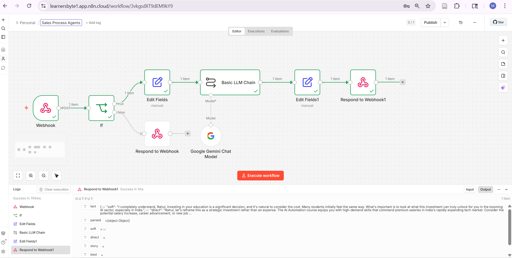

# 🤖 Sales Process Agents: AI Objection Handler Agent (n8n)

> An AI-powered sales automation workflow built with n8n that intelligently handles customer objections, generates persuasive responses, and supports sales teams in improving lead conversion rates.

## 📖 Overview

The **AI Objection Handler Agent** automates one of the most critical stages of the sales process—addressing customer objections. Using AI and workflow automation, the agent analyzes customer concerns, identifies objection types, and generates contextual responses to help sales representatives engage prospects effectively.

This solution reduces manual effort, ensures consistent communication, and accelerates the sales cycle.

## ✨ Key Features

- 🔹 Automated objection detection and classification
- 🔹 AI-generated contextual sales responses
- 🔹 Real-time workflow automation using n8n
- 🔹 Consistent and scalable sales communication
- 🔹 Easy integration with CRM and messaging platforms
- 🔹 Customizable objection-handling logic

## 🛠️ Tech Stack

- **n8n**
- **AI / LLM Integration**
- **Webhook Triggers**
- **HTTP API Requests**
- **JSON Workflows**

## 🔄 Workflow

```text
Customer Objection
        │
        ▼
  Webhook Trigger
        │
        ▼
 Objection Analysis
        │
        ▼
   AI Processing
        │
        ▼
 Response Generation
        │
        ▼
 Sales Recommendation
        │
        ▼
 CRM / Communication Channel
```

## 📸 Workflow Screenshot


image.png

## 🎯 Business Value

- Improves sales team productivity
- Reduces response time to customer concerns
- Delivers consistent messaging across interactions
- Enhances customer engagement and trust
- Supports higher lead conversion opportunities


## 🔮 Future Enhancements

- Sentiment Analysis
- Multi-language Support
- CRM Integrations
- Sales Analytics Dashboard
- Automated Follow-up Workflows
- Customer Intent Prediction

## 👨‍💻 Author

**Manya B.J**

Computer Science & Artificial Intelligence Engineering Graduate


---

⭐ If you found this project useful, consider giving the repository a star.
